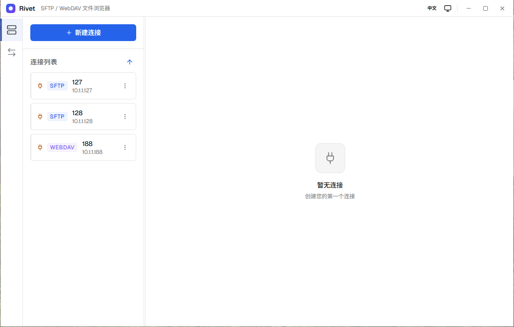

# Rivet

[](https://github.com/RealChuan/Rivet/actions/workflows/build.yml)[](LICENSE)

Rivet is a cross-platform (Windows/macOS/Linux) remote server desktop file browser that supports**SFTP**、**SMB**、**WebDAV**and**Sz**(Compatible with AWS S3, Cloudflare R2, Backblaze B2 and other services). It uses the remote directory as a local file manager: connection, browsing, uploading and downloading, renaming, deleting, copying and moving, conflict handling and transmission management are all completed in the same window.

-   Simplified Chinese |[English](README.en.md)
-   [Architecture description](docs/architecture.md)
-   [Development Agreement](AGENTS.md)



## Function

### connect

-   **SFTP**: Password, private key + password, SSH agent; host key confirmation and known-hosts memory for first connection.
-   **SMB**:SMB 2.0.2 / 2.1 share, NTLMv2 password authentication; fill in the host, port and share name exported by the server. Suitable for Windows shares and NAS. SMB3, signing, encryption, and Kerberos are not currently supported.
-   **WebDAV**: Basic/Digest authentication, custom base path, self-signed certificate switch.
-   **Sz**: Any S3 compatible endpoint, which can be configured with region, bucket, path-style and bucket prefix; the bucket name can be directly selected from the bucket list of the account, no need to remember it. Upload multipart, supporting files larger than 5 GiB.
-   **Paste address link**: Recognize from clipboard`sftp://`、`smb://`、`webdav(s)://`Address, automatically fill in the new connection form.
-   Multi-connection management; connection configuration persistence, password only in the main process`safeStorage`Encrypted storage, the private key only saves the path.

### File management

-   List/grid view, virtual scrolling, sorting, box selection, right-click menu and commonly used shortcut keys.
-   When an item is dragged to another directory, it is moved; the name column is the drag source, and the remaining columns and blank spaces are still selected.
-   Forward/backward, address bar, current directory filtering; copy path and favorite folders.
-   Each server remembers the last directory it stayed in, and will return directly to the original location upon reconnection or next startup.
-   Create new folder, rename, delete, copy, move, refresh.
-   Large directories are loaded in pages. You can continue loading if the list is not finished at one time.
-   Folder attribute statistics: number of files, number of folders, total size; the status bar displays the total size of the selected files and the number of folders.
-   Upload/download conflict handling: overwrite, skip, retain both, can be applied to all.

### transmission

-   Uploading and downloading files and folders supports drag and drop uploading.
-   Upload and download have independent concurrency upper limits (1–10); the speed can be limited separately (KB/s, 0 means no speed limit), and concurrent tasks in the same direction share this quota.
-   Task progress and speed, sub-file progress, failure details, cancellation and retry.
-   The download can be paused/continued: when continuing, the downloaded bytes will be transferred again, and the files that have been downloaded will not be downloaded again; the folder will be judged as completed by "the file is present and there is no semi-finished product". Uploading does not currently support resumed uploading.
-   Bottom transmission queue can be collapsed, raised or maximized; grouped by session when across connections.

### terminal

-   SFTP connections can open an interactive shell in the bottom drawer,`` Ctrl+` ``Toggle; automatically when turned on`cd`Go to the current browsing directory.
-   Live and die with the file session: disconnection or heartbeat loss will also close the terminal.
-   Only the most basic command interaction: no multi-tab, tmux, port forwarding, session recovery, and no local shell.
-   When the server rejects the shell, it prompts "This server does not allow interactive shells"; only the sftp subsystem is allowed (for example`ForceCommand internal-sftp`) will print the original text on the server and mark it as "Exited". It is determined that only the error text of ssh2 can be matched.
-   SMB, WebDAV, and S3 do not provide terminal entry.

### experience

-   Light/Dark/Follow system theme; Mica for Windows 11 22H2+, vibrancy for macOS 13+.
-   Chinese/English interface.
-   Single window, adjustable sidebar, native window control; when closing the window, it will be minimized to the tray by default to continue the transfer (can be changed to exit), and there will be system notifications for background completion or failure.

## SMB instructions

Currently SMB is based on`v9u-smb2`, the three upstream defects are bypassed at the application layer without modifying the dependent source code:`readdir`Pass the file list as a handle to CLOSE. Therefore, the directory handle may be leaked and deleted only through delete-pending (instead, its message layer is reused and traversed by itself.`src/main/providers/smb/readdir.ts`); write stream in`_final`/`_destroy`Repeat CLOSE (only close once after packaging);`CREATE`of`DesiredAccess`Bring a catalog-specific`FILE_DELETE_CHILD`, Samba returns the existing file`ACCESS_DENIED`(Eliminated during message generation phase).

Sessions are reused according to the idle pool (upper limit 4), and failed operations will be replaced with new sessions; concurrent reading and writing each occupy one session, and parallel transmissions still have their own TCP connections. Press once after deleting`stat`Qualitative: A failure will be reported if the entry is still there, and only delete-pending will be tried again.

Known limitations: rename/move fixed`ReplaceIfExists=true`, returned when the target already exists or is occupied on Windows`ACCESS_DENIED`, the interface prompts you with insufficient permissions.

## S3 description

Object storage has no directories, no renames, and no atomic overrides: directories are prefixed, and empty directories are zero bytes.`<prefix>/`The mark is maintained, and the name change is copy + delete (directory rename will be moved one by one, and interruption will leave some copies). The uploaded data will not be visible to the reader before multipart is completed. File name (key) is case sensitive,`#`、`%`、`+`, spaces are encoded by the SDK.

Write by extension when uploading`Content-Type`(Images, PDFs, and texts can be opened directly in the browser). Right-click to generate a pre-signed link for a single object, which is valid for one day by default.

Known limitations: version control and ACL/bucket policies are not supported; STS temporary credentials (sessionToken) are not implemented; the "path" is based on the prefix in the bucket and cannot be browsed across buckets.

## technology stack

| layer     | Selection                                                                      |
| --------- | ------------------------------------------------------------------------------ |
| desktop   | Electron、electron-forge                                                        |
| interface | React、TypeScript、Vite、Zustand、TanStack Query / Virtual                         |
| protocol  | ssh2、undici、fast-xml-parser、v9u-smb2、@aws-sdk/client-s3 与 s3-request-presigner |
| log       | electron-log (roll by day + size)                                              |

## develop

Environmental requirements: Node 24 LTS, pnpm 12.

```powershell
pnpm install
pnpm run dev
pnpm run verify
```

-   `pnpm run verify`Execute typecheck, lint, unit testing, type testing, i18n checking, production dependency auditing and packaging in sequence.
-   Real service integration test (provider layer, verify is not entered by default): start first`scripts/sftp/serve.py`and`scripts/dav/serve.py`(or Docker), then`RIVET_INTEGRATION=1 pnpm run test:integration`;S3 use case connects by default`127.0.0.1:9000`, available`RIVET_S3_ENDPOINT`、`RIVET_S3_BUCKET`、`RIVET_S3_ACCESS_KEY`、`RIVET_S3_SECRET_KEY`Point to any S3 compatible endpoint. SMB use case connects by default`127.0.0.1:1445`,use`RIVET_SMB_*`cover.
-   E2E requires Docker:`pnpm run e2e:servers`→`pnpm run build`→`pnpm run test:e2e`→`pnpm run e2e:servers:down`. E2E includes SFTP, SSH terminal, SMB (Samba, SMB2-only), WebDAV and S3 (s3mock).
-   Manually verify the SFTP page:`python scripts/sftp/serve.py`(Paramiko, see dependencies`scripts/sftp/requirements.txt`；`--auth publickey`、`--emit-client-key`、`--readonly`、`--rotate-host-key`switch branches).
-   Manually verify SMB page: connect to a real SMB2 server; used when the share name is not known`python scripts/smb/list-shares.py <host> --user <user>`enumerate.
-   Manually verify WebDAV pages:`python scripts/dav/serve.py`(WsgiDAV, see dependencies`scripts/dav/requirements.txt`；`--auth digest`、`--https`、`--base-path`、`--readonly`switch branches).
-   Manually verify S3 pages:`python scripts/s3/serve.py`(moto, dependency see`scripts/s3/requirements.txt`; Used when Docker is not installed on this machine).
-   For more commands and engineering conventions see[AGENTS.md](AGENTS.md)。

## Architecture

The main process holds windows, connections, filesystems, transports, and secrets; the rendering layer only accesses capabilities through typed IPC contracts; protocol differences converge at`FileProvider`. See details[docs/architecture.md](docs/architecture.md)。

## license

[GPL-3.0](LICENSE)
