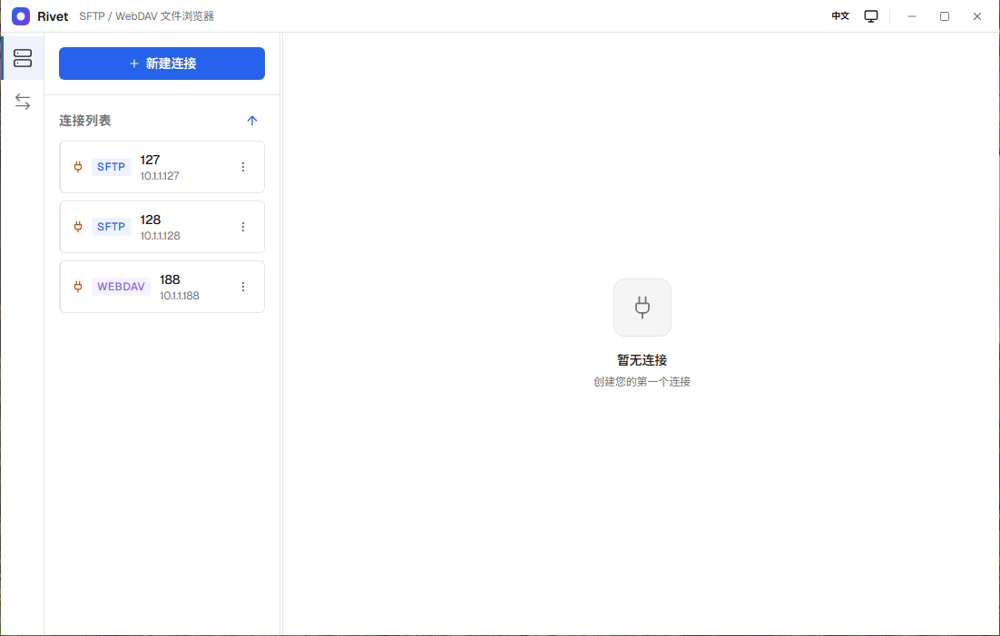

# Rivet

[](https://github.com/RealChuan/Rivet/actions/workflows/build.yml)[](LICENSE)

Rivet is a cross-platform (Windows/macOS/Linux) remote server desktop file browser that supports**SFTP**and**WebDAV**. It uses the remote directory as a local file manager: connection, browsing, uploading and downloading, renaming, deleting, copying and moving, conflict handling and transmission management are all completed in the same window.

-   Simplified Chinese |[English](README.en.md)
-   [架构说明](docs/architecture.md)
-   [Development Agreement](AGENTS.md)



## Function

### connect

-   **SFTP**: Password, private key + password, SSH agent; host key confirmation and known-hosts memory for first connection.
-   **WebDAV**: Basic/Digest authentication, custom base path, self-signed certificate switch.
-   Multi-connection management; connection configuration persistence, password only in the main process`safeStorage`Encrypted storage, the private key only saves the path.

### File management

-   List/grid view, virtual scrolling, sorting, box selection and right-click menu.
-   Create new folder, rename, delete, copy, move, refresh.
-   Folder attribute statistics: number of files, number of folders, total size.
-   Upload/download conflict handling: overwrite, skip, retain both, can be applied to all.

### transmission

-   Uploading and downloading files and folders supports drag and drop uploading.
-   Upload and download have independent concurrency upper limits (1–10).
-   Task progress, sub-file progress, failure details, cancellation and retry.
-   The transfer panel is grouped by session, and complete error messages can be viewed for failed tasks.

### experience

-   Light/Dark/Follow system theme; native frosted glass effect for Windows 11/macOS 26+.
-   Chinese/English interface.
-   Single window, adjustable sidebar, native window control; when there is active transmission, it will be confirmed twice before closing.

## technology stack

| layer     | Selection                                              |
| --------- | ------------------------------------------------------ |
| desktop   | Electron、electron-forge                                |
| interface | React、TypeScript、Vite、Zustand、TanStack Query / Virtual |
| protocol  | ssh2、undici、fast-xml-parser                            |
| log       | electron-log (roll by day + size)                      |

## develop

Environmental requirements: Node 24 LTS, pnpm 12.

```powershell
pnpm install
pnpm dev
pnpm run verify
```

-   `pnpm run verify`Execute typecheck, lint, unit testing, type testing, i18n checking, production dependency auditing and packaging in sequence.
-   E2E requires Docker:`pnpm e2e:servers`→`pnpm run build`→`pnpm test:e2e`→`pnpm e2e:servers:down`。
-   For more commands and engineering conventions see[AGENTS.md](AGENTS.md)。

## Architecture

The main process holds windows, connections, file systems, transports, and secrets; the rendering layer only accesses capabilities through typed IPC contracts; protocol differences converge at`FileProvider`. See details[docs/architecture.md](docs/architecture.md)。

## license

[GPL-3.0](LICENSE)
