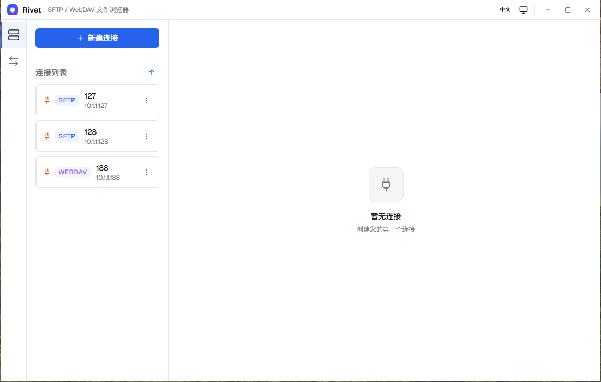

# Rivet

[](https://github.com/RealChuan/Rivet/actions/workflows/build.yml)
[](LICENSE)

Rivet 是一个跨平台（Windows / macOS / Linux）的远程服务器桌面文件浏览器，支持 **SFTP**、**SMB**、**WebDAV** 与 **S3**（兼容 AWS S3、Cloudflare R2、Backblaze B2 等服务）。它把远端目录当作本地文件管理器来用：连接、浏览、上传下载、改名、删除、复制移动、冲突处理和传输管理都在同一个窗口完成。

- 简体中文 | [English](README.en.md)
- [架构说明](docs/architecture.md)
- [开发约定](AGENTS.md)



## 功能

### 连接

- **SFTP**：密码、私钥 + 口令、SSH agent；首次连接的主机密钥确认与 known-hosts 记忆。
- **SMB**：SMB 2.0.2 / 2.1 共享，NTLMv2 密码认证；填主机、端口和服务器导出的共享名。适合 Windows 共享与 NAS。当前不支持 SMB3、签名、加密与 Kerberos。
- **WebDAV**：Basic / Digest 认证、自定义基础路径、自签证书开关。
- **S3**：任意 S3 兼容端点，可配 region、桶、path-style 与桶内前缀；桶名可从账号的桶列表里直接选，不用记。上传走 multipart，支持超过 5 GiB 的文件。
- **粘贴地址连接**：从剪贴板识别 `sftp://`、`smb://`、`webdav(s)://` 地址，自动填好新建连接表单。
- 多连接管理；连接配置持久化，密码只在主进程经 `safeStorage` 加密存储，私钥只保存路径。

### 文件管理

- 列表 / 宫格视图，虚拟滚动、排序、框选、右键菜单与常用快捷键。
- 条目拖到其它目录即移动；名称列是拖动源，其余列与空白处仍是框选。
- 前进 / 后退、地址栏、当前目录过滤；复制路径与收藏文件夹。
- 每台服务器记住最后停留的目录，重连或下次启动直接回到原处。
- 新建文件夹、重命名、删除、复制、移动、刷新。
- 大目录分页加载，一次没列完可继续加载。
- 文件夹属性统计：文件数、文件夹数、总大小；状态栏显示选中文件的总大小与文件夹数量。
- 上传 / 下载冲突处理：覆盖、跳过、保留两者，可应用到全部。

### 传输

- 文件与文件夹的上传、下载，支持拖拽上传。
- 上传、下载各自独立的并发上限（1–10）。
- 任务进度与速度、子文件进度、失败详情、取消与重试。
- 下载可暂停 / 继续：继续时从已下载的字节接着传，已落盘的文件不再重下；文件夹按「文件在且没有半成品」判定已完成。上传暂不支持断点续传。
- 底部传输队列可收起、拖高或最大化；跨连接时按会话分组。

### 终端

- SFTP 连接可以在底部抽屉里打开交互式 shell，`` Ctrl+` `` 切换；打开时自动 `cd` 到当前浏览目录。
- 与文件会话同生共死：断开连接或心跳掉线会一并关闭终端。
- 只做最基础的命令交互：没有多标签、tmux、端口转发、会话恢复，也没有本地 shell。
- 服务器拒绝 shell 时提示「该服务器不允许交互式 shell」；只放行 sftp 子系统的（例如 `ForceCommand internal-sftp`）会打印服务端原文后标为「已退出」。判定只能匹配 ssh2 的错误文案。
- SMB、WebDAV、S3 不提供终端入口。

### 体验

- 浅色 / 深色 / 跟随系统主题；Windows 11 22H2+ 的 Mica、macOS 13+ 的 vibrancy。
- 中文 / English 界面。
- 单窗口、可调整侧栏、原生窗口控制；关窗默认最小化到托盘继续传输（可改为退出），后台完成或失败有系统通知。

## SMB 说明

当前 SMB 基于 `v9u-smb2`，上游有三处缺陷：`readdir` 结束时不关闭目录句柄，删除目录可能只进入 delete-pending，断开连接后才真正消失；写流在 `_final` 和 `_destroy` 中重复 CLOSE，上传会收到 `STATUS_FILE_CLOSED`；每次 `CREATE` 都在 `DesiredAccess` 里带上 `FILE_DELETE_CHILD`（目录才有的权限位），Samba 因此对既有文件的打开请求直接回 `STATUS_ACCESS_DENIED`，stat、下载、删除、重命名全部失败。

应用层对策：每次 SMB 操作使用独立连接并在结束时断开；删除后用独立连接轮询 `stat` 确认条目已消失，未消失则报删除失败；在 CREATE 消息生成阶段剔除 `FILE_DELETE_CHILD`（`src/main/providers/smb/client.ts`）；包装写流的 `_final`/`_destroy`（读流 EOF 同理），保证底层句柄只关闭一次。不修改依赖源码，代价是每次操作多一次会话建立。

已知限制：改名/移动固定 `ReplaceIfExists=true`，Windows 上目标已存在或被占用时返回 `ACCESS_DENIED`，界面按权限不足提示。

## S3 说明

对象存储没有目录、没有 rename，也没有原子覆盖：目录是前缀，空目录靠零字节的 `<prefix>/` 标记维持，改名是 copy + delete（目录改名会逐个对象搬运，中断会留下部分副本），上传的数据在 multipart 完成前对读端不可见。文件名（key）大小写敏感，`#`、`%`、`+`、空格由 SDK 负责编码。

已知限制：不支持版本控制、ACL/桶策略与预签名分享；STS 临时凭证（sessionToken）未实现；「路径」以桶内前缀为根，不能跨桶浏览。

## 技术栈

| 层   | 选型                                                        |
| ---- | ----------------------------------------------------------- |
| 桌面 | Electron、electron-forge                                    |
| 界面 | React、TypeScript、Vite、Zustand、TanStack Query / Virtual  |
| 协议 | ssh2、undici、fast-xml-parser、v9u-smb2、@aws-sdk/client-s3 |
| 日志 | electron-log（按天 + 按大小滚动）                           |

## 开发

环境要求：Node 24 LTS、pnpm 12。

```powershell
pnpm install
pnpm run dev
pnpm run verify
```

- `pnpm run verify` 依次执行 typecheck、lint、单元测试、类型测试、i18n 检查、生产依赖审计与打包。
- 真实服务集成测试（provider 层，默认不进 verify）：先起 `scripts/sftp/serve.py` 与 `scripts/dav/serve.py`（或 Docker），再 `RIVET_INTEGRATION=1 pnpm run test:integration`；S3 用例默认连 `127.0.0.1:9000`，可用 `RIVET_S3_ENDPOINT`、`RIVET_S3_BUCKET`、`RIVET_S3_ACCESS_KEY`、`RIVET_S3_SECRET_KEY` 指向任意 S3 兼容端点。
- E2E 需要 Docker：`pnpm run e2e:servers` → `pnpm run build` → `pnpm run test:e2e` → `pnpm run e2e:servers:down`。E2E 包含 SFTP、SSH 终端、SMB（Samba，SMB2-only）、WebDAV 与 S3（s3mock）。
- 手动验证 SFTP 页面：`python scripts/sftp/serve.py`（Paramiko，依赖见 `scripts/sftp/requirements.txt`；`--auth publickey`、`--emit-client-key`、`--readonly`、`--rotate-host-key` 切换分支）。
- 手动验证 SMB 页面：连接真实 SMB2 服务器；不知道共享名时用 `python scripts/smb/list-shares.py <host> --user <user>` 枚举。
- 手动验证 WebDAV 页面：`python scripts/dav/serve.py`（WsgiDAV，依赖见 `scripts/dav/requirements.txt`；`--auth digest`、`--https`、`--base-path`、`--readonly` 切换分支）。
- 手动验证 S3 页面：`python scripts/s3/serve.py`（moto，依赖见 `scripts/s3/requirements.txt`；本机没装 Docker 时用）。
- 更多命令与工程约定见 [AGENTS.md](AGENTS.md)。

## 架构

主进程持有窗口、连接、文件系统、传输与秘密；渲染层只通过类型化 IPC 契约访问能力；协议差异收敛在 `FileProvider`。详见 [docs/architecture.md](docs/architecture.md)。

## 许可证

[GPL-3.0](LICENSE)
